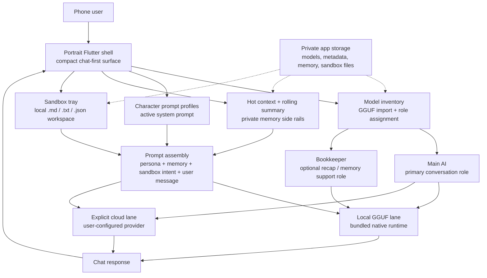

# Chatty-mini

Chatty-mini is a portrait-first Android Flutter app for local GGUF chat on small phones, with optional user-configured cloud lanes when a hosted provider is the better fit.

It is intentionally narrow in scope:

- local inference by default, with optional user-configured cloud models
- minimal chrome
- compact main chat surface
- user-managed GGUF models
- bundled native runtime
- sandbox files for lightweight local notes and JSON state
- saved character prompt profiles
- hot context and rolling summary side rails

The operating stance is local first, cloud optional: local when you want device-side control, cloud when you deliberately choose a provider.

## Install

- Google Play: <https://play.google.com/store/apps/details?id=io.instance001.chatmini>
- Direct APK: <https://github.com/instance001/chatty-mini/releases/download/v1.0.0-b3/chatty-mini-v1.0.0-b3.apk>
- Latest releases: <https://github.com/instance001/chatty-mini/releases>
- Obtainium: add this GitHub repository and track releases.

The direct APK is provided for users who prefer GitHub release installs or Obtainium updates. Google Play remains the easiest install path for most Android users.

## Screenshots


| Chat and memory | Tools and setup |
| --- | --- |
|  |  |
|  |  |
|  |  |


## Current Direction

The app is being shaped for devices like the Samsung A21s and similar small portrait Android phones. The main hierarchy is:

- header
- compact status strip
- compact runtime health row
- chat
- composer

Most detailed system information is pushed into trays and sheets so the main screen stays focused on "open app, see local, chat."

## App Flow Map



## Main Features

- Bundled Android native runtime packaged with the app build
- Import GGUF files through Android document picker into private app storage
- Separate model assignment for Main AI and Bookkeeper roles
- Optional OpenAI, Anthropic, Gemini, xAI, DeepSeek, and custom OpenAI-compatible entries in the same role selectors
- Android Keystore-encrypted API keys and explicit provider verification
- Mobile-oriented generation presets
- Model health assessment for small-phone fit
- Saved character prompt profiles with active persona switching
- Sandbox tray for `.md`, `.txt`, and `.json` files
- User-directed sandbox export through Android's document picker
- Deterministic sandbox task mode in the composer for targeted file work
- Cold log and session log management
- Compact runtime details sheet

## Important Storage Model

Chatty-mini uses private app storage for runtime metadata, imported models, memory files, and sandbox files.

That means:

- users do not browse the real internal app folders directly
- GGUF import happens through the app
- model deletion happens through the app
- persona exports can be written into the sandbox as JSON files
- sandbox files can be opened and edited inside the app
- sandbox files can be exported to Downloads or another user-selected location

## Privacy

Local GGUF use does not send prompts or files to FMI. When a user explicitly selects a configured cloud model, Chatty-mini sends the prompt and relevant app context directly to that provider or custom endpoint. Cloud API keys are encrypted locally using Android Keystore. No cloud lane is selected implicitly.

- [Google Play](https://play.google.com/store/apps/details?id=io.instance001.chatmini)
- [Direct APK release](https://github.com/instance001/chatty-mini/releases/tag/v1.0.0-b3)
- [Chatty-mini Privacy Policy](https://instance001.github.io/privacy/chatty-mini.html)
- [FMI Google Play releases](https://instance001.github.io/google-play.html)

## Documentation

- User manual: [docs/USER_MANUAL.md](docs/USER_MANUAL.md)
- Glossary: [GLOSSARY.md](GLOSSARY.md)

## License

Chatty-mini is free and open-source software released under the [GNU Affero General Public License v3.0](LICENSE).

You may use, study, modify, and redistribute the software under the AGPLv3 terms. If you modify Chatty-mini and make it available for others to use over a network, you must also offer those users the corresponding source code for your modified version as required by the licence.

Bundled and vendored third-party components, including `llama.cpp`, retain their respective upstream copyright and licence notices.

## Development

### Requirements

- Flutter SDK
- Android toolchain / Gradle
- Android device or emulator for testing

### Useful Commands

Run from the repository root:

```powershell
flutter pub get
dart format lib test
flutter analyze
flutter test
```

Run Android debug build from `android/`:

```powershell
.\gradlew.bat assembleDebug
```

Run Android release build from `android/`:

```powershell
.\gradlew.bat assembleRelease
```

Run to a connected device from the repository root:

```powershell
flutter run -d "<device name>"
```

### Notes

- The app currently targets a bundled-runtime path rather than asking users to install a runtime manually after install.
- Local GGUF remains the default. Cloud requests occur only when a cloud entry is explicitly selected; there is no automatic fallback.
- The workspace contains bundled upstream `llama.cpp` source under Android native code.
- Gradle currently emits deprecation warnings around built-in Kotlin migration. Those flags are intentionally still pinned in `android/gradle.properties` because removing them currently crashes the Flutter Gradle plugin during Android release configuration.
- Android release identity is set to `io.instance001.chatmini`.
- Release signing uses a local, ignored `android/key.properties` file when supplied. Without it, local release builds fall back to debug signing.

## Release Signing

For a signed release, place these files in `android/`:

- `key.properties`
- your `.jks` upload keystore

Start from [android/key.properties.template](android/key.properties.template) and replace the placeholder values with your real signing details.

The real `key.properties` and keystore files are ignored by Git.

## Project Status

This repository state is a working mobile prototype focused on:

- small-phone usability
- local-first GGUF workflow
- reduced dashboard clutter
- practical import / cleanup flows
- persona and sandbox assistance

The Android package ID is `io.instance001.chatmini`. Privacy disclosures and store-facing links are maintained alongside the source.
